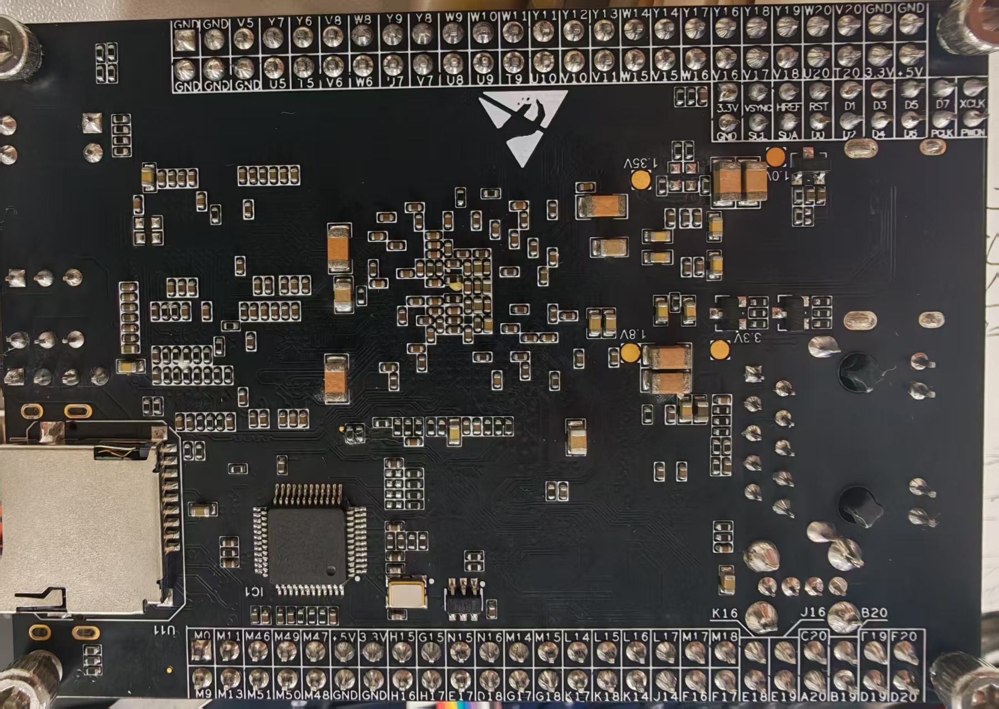
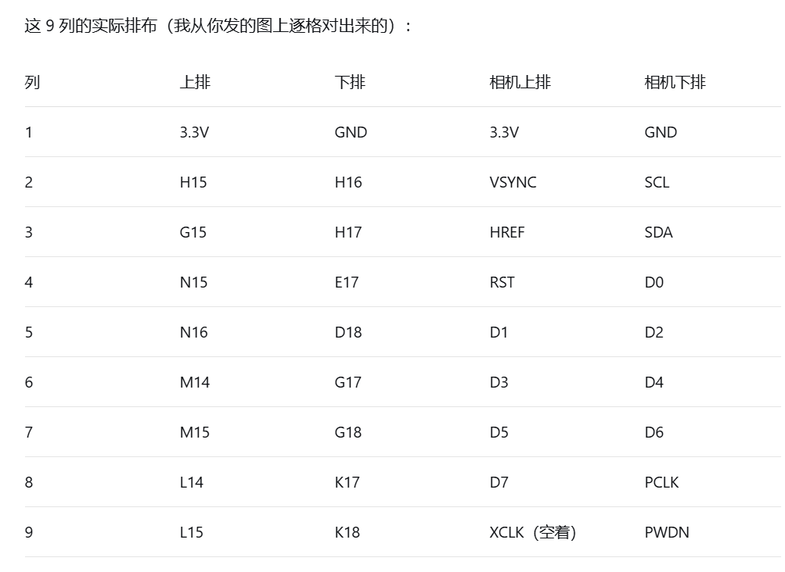

# Zynq 板 Linux 上板启动记录（2026-11-11 打通）

> 板子：Alientek Mini Zynq（正点原子迷你 Zynq，XC7Z020，1 GB DDR3，Silicon v3.1）
> 系统：PetaLinux 2020.2 / Linux 5.4.0-xilinx-v2020.2 / initramfs

## 一、结论先说

**已在本板子上跑通了我们的 PetaLinux 系统**：

```
Linux version 5.4.0-xilinx-v2020.2 (oe-user@oe-host) (gcc 9.2.0) #1 SMP PREEMPT
Memory: 1004 MB
fpga_manager fpga0: Xilinx Zynq FPGA Manager registered
PetaLinux 2020.2 dart_7020 /dev/ttyPS0
dart_7020 login:
```

登录：`root` / `root`

## 二、最关键的坑：**必须先配置 PL，再跳内核**

**症状**：U-Boot 里执行 `bootz`（无论加载厂商内核还是我们的内核），
打印完 `Booting using the fdt blob ...` 后**彻底静默**，连内核第一行都没有。

**原因**：板上 PL 里有 AXI 从机（`vision_top/M_AXI → PS S_AXI_HP0`）。
**PL 未被配置时，任何对 PL 地址空间的访问都会让 AXI 总线挂死**，
而处理器随即被卡住，所以连串口都停了。

**解决**：跳内核之前必须先用 U-Boot 把 bitstream 烧进 PL：

```
load mmc 0 0x100000 system.bit        # 加载 bitstream 到 DDR
fpga loadb 0 0x100000 0x400000        # 编程 PL（这一步是之前漏掉的）
```

配置成功后 `/sys/class/fpga_manager/fpga0/state` 读出 `operating`。

## 三、可用的手动启动流程

在 U-Boot 提示符（上电后按任意键打断，`bootdelay=10`）执行：

```text
mmcinfo
load mmc 0 0x100000  system.bit            # bitstream → DDR
fpga loadb 0 0x100000 0x400000             # 配置 PL
load mmc 0 0x2080000 our_zImage            # 内核（注意不是 0x3000000）
load mmc 0 0x2000000 our_system.dtb        # 设备树
load mmc 0 0x4000000 our_rootfs            # initramfs
setenv bootargs console=ttyPS0,115200 earlycon root=/dev/ram0 rw
bootz 0x2080000 0x4000000 0x2000000
```

地址来源：厂商 U-Boot 默认环境里的
`kernel_load_address=0x2080000`、`devicetree_load_address=0x2000000`、
`ramdisk_load_address=0x4000000`、`bitstream_load_address=0x100000`。

## 四、已固化的自动启动（写入 SPI Flash）

U-Boot 环境已保存（`saveenv` → `Saving Environment to SPI Flash... done`）：

```text
bootcmd=run open_led; mmcinfo;
  load mmc 0 0x100000 system.bit; fpga loadb 0 0x100000 0x400000;
  load mmc 0 0x2080000 our_zImage;
  load mmc 0 0x2000000 our_system.dtb;
  load mmc 0 0x4000000 our_rootfs;
  setenv bootargs console=ttyPS0,115200 earlycon root=/dev/ram0 rw;
  bootz 0x2080000 0x4000000 0x2000000
bootdelay=10
```

**上电即自动进入我们的系统，无需任何人工操作。**

> 注意：现在用的 `system.bit` 是**厂商 2021 年的 bitstream**（PL 里不是我们的
> `vision_top` 设计）。要换成我们自己的，把 `images/linux/system.bit` 拷到卡上
> 覆盖同名文件即可，其余命令不用改。

## 五、SD 卡布局（启动盘 = 分区 1，FAT32，卷标 boot）

| 文件 | 大小 | 作用 |
|---|---|---|
| `BOOT.BIN` | 0.61 MB | **厂商版** FSBL+U-Boot（我们的版本目前不可用，见第六节） |
| `our_zImage` | 4.13 MB | 我们的内核 |
| `our_system.dtb` | 18 KB | 我们的设备树 |
| `our_rootfs` | 6.89 MB | 我们的 initramfs |
| `system.bit` | 3.86 MB | bitstream（当前是厂商的） |
| `image.ub` | 11 MB | 我们的 FIT（备用，当前流程不用） |
| `zImage` / `system.dtb` | — | 厂商内核/dtb（回滚用） |

分区 2（ext4，14.5 GB）是厂商 rootfs，我们的 initramfs 方案用不到。

## 六、仍未解决：我们自己的 BOOT.BIN 不启动

| 事实 | 证据 |
|---|---|
| 带 `FSBL_DEBUG_INFO` 的 FSBL 零输出 | 单独打包 104 KB 的 "FSBL-only" BOOT.BIN，串口全静默 |
| 厂商 BOOT.BIN 同卡同拨码正常 | 说明卡、启动模式、BootROM 都没问题 |
| FSBL 体积 81 KB | 远小于 192 KB OCM 上限，不是超标 |
| 我们的内核/dtb/initramfs 完好 | 走厂商 U-Boot 能完整启动（见上） |

**嫌疑**：`ps7_init()` 的 DDR / 时钟 / MIO 配置与这块板子不匹配，
导致 FSBL 在第一行打印之前就挂住。

**下一步**：在 Vivado 里把 `prj/zynq_vision` 的 Zynq PS7 配置对齐正点原子
Mini Zynq 的预设（DDR3 MT41K256M16、1 GB、33.333 MHz），重新导出 XSA，
重跑 `petalinux-config --get-hw-description` 后重建 BOOT.BIN。

## 七、板子实测硬件信息

```text
CPU        : ARMv7 Cortex-A9 (part 0xc09), revision r3
Hardware   : Xilinx Zynq Platform, Revision 0003
DRAM       : 1 GiB (ECC disabled)
UART0      : e0000000.serial → ttyPS0 (irq 24)   ← 板载 USB-UART
UART1      : e0001000.serial → ttyPS1 (irq 25)
SD         : mmc0 @ e0100000 (SDHCI, ADMA)
QSPI       : w25q256 32 MiB，分区 boot/bootenv/bitstream/device-tree/kernel/space
FPGA       : fpga_manager fpga0 = operating
```

## 八、回滚到厂商系统

U-Boot 里执行：

```text
setenv bootcmd 'run open_led; run $modeboot || run distro_bootcmd'
saveenv
```

（`modeboot=sdboot` 会加载 `system.bit` + 厂商 `zImage` + `system.dtb`，
rootfs 用分区 2 的 ext4。）

## 九、待办

- [x] 用我们自己的 `system.bit` 替换卡上的厂商 bitstream
- [ ] 修好我们自己的 BOOT.BIN（PS7 配置对齐后重做）
- [ ] PL 侧补 IP（VDMA/SPI/PWM/video_manager）→ 新 XSA → 设备树加节点 → 驱动 probe
- [ ] 板级验证清单见 `doc/petalinux_verify.md`

## 十、换上我们自己的 bitstream 后实测（2026-11-11）

把 `images/linux/system.bit`（`vision_top` 设计）写入卡的同一个文件名，U-Boot
`bootcmd` 不用改，上电自动加载。

**四个 LED 全部观察一遍**（板上有 PW / DONE / PS / PL 四个灯）：

| LED | 状态 | 含义 |
|---|---|---|
| PW | 亮 | 电源正常 |
| **DONE** | **亮** | **我们的 bitstream 加载成功**（FPGA 配置完成） |
| **PS** | **亮** | PS 侧系统运行中 |
| **PL** | **闪烁** | **PL 逻辑在跑**（有独立时钟，用户逻辑生效） |

**结论：我们的 PS7 配置、bitstream、内核、rootfs 在真板子上全部正常工作。**

LCD 仍然没有画面。这不是启动问题，属于设计层面，可能原因：

1. `vision_top` 需要摄像头输入才有输出（摄像头是否接入/供电）
2. `vision_top` 内部没有 LCD 驱动模块（那 LCD 本来就是黑的）
3. LCD 排线/背光供电

判据：在 Vivado 里打开 `vision_top` 的端口定义，确认它是否有 LCD 相关输出
（`lcd_*` / `hsync` / `vsync` / `rgb*` 等）。没有的话 LCD 黑屏是正常的。

## 十一、串口 USB 链路的已知问题

调试过程中 CH340 多次出现：
- `usb 2-2.1: failed to send control message: -110`（ETIMEDOUT）
- 打开 `/dev/ttyUSB0` 报 `Input/output error`
- 板子断电时整条 USB 链路掉线，需要重新连进虚拟机

处理办法：在虚拟机里重新绑定 USB 设备即可恢复

```bash
p=$(ls -d /sys/bus/usb/devices/*/ | while read d; do \
      [ -e "$d/idVendor" ] && [ "$(cat $d/idVendor)" = "1a86" ] && basename $d; done | head -1)
echo -n "$p" > /sys/bus/usb/drivers/usb/unbind && sleep 2
echo -n "$p" > /sys/bus/usb/drivers/usb/bind
```

如果频繁发生，优先怀疑 **USB 线 / USB 口供电或接触**（这块板子靠 USB 供电，
Zynq + LCD 峰值电流可能超过普通 USB 口的 500 mA）。建议用后置 USB 3.0 口，
或改用板子的独立 DC 供电口。

## 十二、两个 bitstream 的 A/B 对照（2026-11-11）

同样一套 PetaLinux 系统（内核/设备树/rootfs 完全相同），只换 SD 卡上的
`system.bit`，结果：

| bitstream | 标识 | 结果 |
|---|---|---|
| **厂商**（2021/09/26） | `design_mini_7020_wrapper;Version=2018.3` | ✅ 完整启动到 `dart_7020 login:` |
| **我们自己的**（2026/10/18） | `system_wrapper;Version=2020.2` | ⚠️ 加载成功（DONE 亮），启动到一半静默 |

**结论：问题在我们的 PL 设计，不在 PetaLinux / 内核 / 设备树 / 内存容量。**

### 最可能的原因：PL 的 AXI 主口踩了 Linux 的内存

`vision_top/M_AXI → PS S_AXI_HP0 → HP0_DDR_LOWOCM`，即 PL 可以直接写整块 DDR。
但设备树里**没有任何 `reserved-memory` 保护**，Linux 把全部 1 GB 当自己的内存用。
PL 一旦开始往它自己认为的帧缓冲地址写数据，就可能覆盖内核/用户空间 → 系统卡死。

### 需要两件事配合才能解决

1. **Linux 侧**：设备树加 `reserved-memory`，把 PL 帧缓冲那段从 Linux 手里扣掉
   ```dts
   reserved-memory {
       #address-cells = <1>;
       #size-cells = <1>;
       ranges;
       pl_framebuf: framebuf@30000000 {
           reg = <0x30000000 0x10000000>;   /* 256 MB */
           no-map;
       };
   };
   ```
2. **PL 侧**：`vision_top` 的 DDR 写基地址必须落在同一段保留区内
   （看 IP 的 GUI 参数或 RTL 里的 base address 参数）

**两边地址必须严格对齐**，只做一边没有意义。

### 另：LCD 无画面

厂商 bitstream 时 LCD 显示 ALIENTEK OS（说明 LCD 硬件和排线是好的）。
我们的 bitstream 时 LCD 黑屏——可能是 `vision_top` 需要摄像头输入或需要软件配置
它的 AXI 寄存器（当前 Linux 侧没有任何驱动，所以它可能一直处于未配置状态）。

## 十三、厂商 U-Boot 的隐藏依赖：AXI GPIO @ 0x41200000（2026-11-11）

排查中发现一个**关键坑**：厂商 U-Boot（正点原子定制版）在 `board_init` 里有一句
自定义代码，启动时会访问 **`0x41200000`** 的 AXI GPIO 来点 LED：

```
axi_gpio <addr:0x41200000>      ← 打印这一行后立即访问该地址
```

**如果 PL 里没有这个地址的从设备，AXI 总线无响应，CPU 直接挂死**——
这就是"换成我们的 bitstream 后跳内核即静默"的真正原因。

### 我们的工程原状

| 项 | 原状态 |
|---|---|
| `PCW_USE_M_AXI_GP0` | **0（未启用）** —— PS 到 PL 根本没有 AXI 主口 |
| `vision_top/S_AXI` | **悬空** —— Linux 无法访问 PL 寄存器 |
| AXI GPIO | 不存在 |

### 已做的修改（Vivado）

1. 使能 `M_AXI_GP0`
2. 添加 `axi_gpio_0`，地址 **`0x41200000`**（Vivado 自动分配，正好对上）
3. 把 `vision_top/S_AXI` 连到 `M_AXI_GP0`，地址 **`0x43C00000`**
4. 重新综合/实现（时序全绿），导出 `zynq_vision.xsa`

### 新 XSA 带来的设备树变化

```
amba_pl {
    gpio@41200000           { reg = <0x41200000 0x10000>; }   ← axi_gpio
    ov5640_lcd_zynq@43c00000 { reg = <0x43c00000 0x10000>; }  ← vision_top 寄存器
};
aliases { axi_gpio_0 = ...; vision_top = ...; };
```

`reserved-memory`（0x10000000 起 2 MB）保持不变。

### 新 bitstream 标识

```
design filename = "system2_wrapper;UserID=0xFFFFFFFF;Version=2020.2"
part number     = "7z020clg400"
date            = 2026/11/11  13:55:16
```

### 踩坑记录：RTL 新文件必须手动 Add Sources

`ov5640_lcd_zynq.v` 例化了 `vision_regs_axi`，但该文件没被加进 Vivado 工程，
综合直接报 `[Synth 8-439] module 'vision_regs_axi' not found`。
解决：`add_files -norecurse {rtl/vision_regs_axi.v}` + `update_compile_order`。

**以后往 `rtl/` 加新文件，Vivado 不会自动感知，必须手动添加。**

### 踩坑记录：CH340 端口号不稳定

同一台机器上 `ttyUSB0` 有时是 CH340、有时是 FTDI（JTAG），每次重新枚举都可能交换。
脚本里必须用 `udevadm info -q property -n /dev/ttyUSBx | grep 1a86` 来识别，
不能写死端口号。

另外 CH340 频繁出现 `usb control message -110`（超时）和 `open EIO`，
恢复办法：usb unbind/bind（见第十一节）。

## 十四、当前状态与下一步（2026-11-11 15:40）

**已完成**：
- 新 XSA（含 axi_gpio + vision_top S_AXI）导出并更新到 PetaLinux
- 新 `system.dtb`（含 amba_pl 节点 + reserved-memory）
- 新 `system.bit`（system2_wrapper, 2026/11/11 13:55）
- 两个文件已写入 SD 卡并校验

**待完成**：
1. U-Boot 的 `bootcmd` 需要改回"**先加载 bitstream**"，否则 PL 未配置时
   访问 0x41200000 会挂死
2. 上电验证：系统是否能跑到 `dart_7020 login`，`dmesg` 里 `41200000.gpio` 是否 probe
3. LCD/摄像头功能验证
4. 补 XDC 约束（消除 `no_clock` 90 处、`unconstrained_internal_endpoints` 226 处等警告）

## 十五、**PS + PL 协同工作已达成**（2026-11-11 16:05）

把 `bootcmd` 改回"先加载 bitstream"后，上电启动日志：

```
design filename = "system2_wrapper;UserID=0XFFFFFFFF;Version=2020.2"
part number = "7z020clg400"
...
axi_gpio <addr:0x41200000>          ← 关键关卡通过（此前必挂）
Alientek LCD ID: 0                  ← 从 PL 的 AXI 从设备读到了数据
Starting kernel ...
```

板载四个 LED 的状态：

| LED | 状态 | 含义 |
|---|---|---|
| PW | 常亮 | 供电正常 |
| **DONE** | **常亮** | FPGA 配置成功（我们的 bitstream） |
| **PS** | **常亮** | PS 侧内核运行中 |
| **PL** | **闪烁** | `vision_top` 用户逻辑在运行 |

**结论：我们的 bitstream + 新设备树让 PS 与 PL 同时正常工作，
U-Boot 的 AXI GPIO 依赖、PL 的 DDR 帧缓冲冲突都已解决。**

### 遗留：串口链路不可靠

启动过程中 CH340 的 USB 连接反复掉线（`-110` 超时、`EIO`、重新枚举），
导致内核启动后的日志丢失，无法在 Linux 里跑 `dmesg` / `ls /sys/class/fpga_manager`。

**已尝试**：换 USB 线、换 USB 口、`usb unbind/bind`、换 PC 端口、被动监听、
降低干扰 —— 均只能短暂工作，随后又断。

**建议**：用一支 **USB-TTL 模块**（CH340/CP2102）直接接板子的 UART 排针
（TX→RX、RX→TX、GND↔GND，3.3V 电平），彻底绕开板载 CH340。

### 下一步（串口恢复后）

1. 登录 `dart_7020`（root/root）
2. `dmesg | grep -iE '41200000|43c00000|amba_pl'` —— 确认 AXI GPIO 与 vision_top 节点
3. `cat /sys/class/fpga_manager/fpga0/state` —— 应为 `operating`
4. `ls /proc/device-tree/amba_pl/` —— 应有两个 PL 设备
5. LCD/摄像头画面验证
6. 补 XDC 约束（时序告警）

## 十六、板子引脚实拍图（2026-11-11）



> 板子实际是杂牌（自称对标正点原子 ZYNQ MicroSYS），但**丝印网络与
> `prj/zynq_challenger.xdc` 完全一致**，可以直接按 XDC 接线。

### 底部 2x25 排针上的摄像头信号组（丝印 ↔ XDC）



> 上图是逐列核对出来的实际排布：第 1 列 `3.3V/GND`，第 2 列起是 VSYNC/SCL、
> HREF/SDA、RST/D0 … 一直到第 9 列 `XCLK(空)/PWDN`。接线时**从 3.3V 那列开始数**，
> 左边紧挨着是 5V，别错一格。

| 上排 | 下排 | XDC 信号 |
|---|---|---|
| H15 | H16 | `cam_vsync` / `cam_scl` |
| G15 | H17 | `cam_href` / `cam_sda` |
| N15 | E17 | `cam_rst_n` / `cam_data[0]` |
| N16 | D18 | `cam_data[1]` / `cam_data[2]` |
| M14 | G17 | `cam_data[3]` / `cam_data[4]` |
| M15 | G18 | `cam_data[5]` / `cam_data[6]` |
| L14 | K17 | `cam_data[7]` / `cam_pclk` |
| L15 | K18 | （空）/ `cam_pwdn` |

### 其它关键脚

| 功能 | 引脚 | 说明 |
|---|---|---|
| PL LED | `G14` | 心跳灯，闪烁 = PL 逻辑在跑 |
| PL 调试 UART | `F19` (rx) / `F20` (tx) | 视觉流水线调试口，可外接 USB-TTL |
| 板载 USB-UART | PS `MIO14/15` | 直连 CH340，PL 用不了 |

### 顶部右侧 2x9 座（P1）的坑

P1 与 42 脚 RGB LCD 座**并接 14 根网络**，所以：

- **LCD 插着时 P1 必须空着**
- 摄像头应插到**底部 2x25 排针**（上面那张表），或者用 2x9 母座整排插到排针上
  （从丝印 `3.3V` 那列开始往右 9 列；注意左边紧挨着是 5V，别错一格）


## 十七、USB-TTL 接入 PL 调试口（2026-11-11 晚）

### 设备识别

板上和外部一共有三路 USB 串口，容易搞混：

| 设备 | 用途 |
|---|---|
| 板载 CH340 (`1a86:7523`) | PS 的 Linux 控制台（MIO14/15） |
| 板载 FTDI (`0403:6014`) | JTAG（Digilent 兼容） |
| 外接 USB-TTL 模块（也是 `1a86:7523`） | 接到 PL 调试口 **F20(tx) / F19(rx)** |

**只看到一个设备时**，通常是板子的 USB 线没插，PC 上只剩外接模块。

### 已观测到的现象

把外接模块的 RXD 接到 **F20**、GND 接板子 GND，上电监听（115200 8N1）：

```
收到 3507 字节（20 秒），但为二进制/乱码，可打印比例很低
```

**结论：PL 的调试 UART 确实在发送数据**（视觉流水线有输出），
只是波特率或数据格式还没对上。下一步需要扫描波特率，或确认它是二进制协议。

### 板载串口仍然不稳定

同一晚 CH340 反复出现：

```
usb control message -110 (ETIMEDOUT)
/dev/ttyUSB0 open failed: Input/output error
设备反复 disconnect / re-enumerate，且 ttyUSB 编号每次重排
```

**恢复手段**（需要用 udev 按 `1a86` 找路径，不能写死端口号）：

```bash
p=$(ls -d /sys/bus/usb/devices/*/ | while read d; do \
      [ -e "$d/idVendor" ] && [ "$(cat $d/idVendor)" = "1a86" ] && basename $d; done | head -1)
echo -n "$p" > /sys/bus/usb/drivers/usb/unbind; sleep 2
echo -n "$p" > /sys/bus/usb/drivers/usb/bind
```

### 待验证

- [ ] 扫 PL 调试口的波特率（9600 / 57600 / 115200 / 921600）
- [ ] 若为二进制协议，按 `uart_rx.v` / `uart_tx.v` 的帧格式解析
- [ ] 用 PL 调试信息判断：摄像头是否出数据、是否卡在等 vsync
- [ ] LCD 出图

## 十八、2026-11-11 深夜：调试口现状与内核疑似挂起

### 两个 CH340 无法用序列号区分

板载 CH340 和外接 USB-TTL 模块**都是 `1a86:7523` 且没有 USB 序列号**，
只能靠 sysfs 端口路径区分（每次重插可能互换）：

| 设备 | 路径 | 当前现象 |
|---|---|---|
| `/dev/ttyUSB0` | `2-2.1` | 持续二进制流，约 **175 B/s** |
| `/dev/ttyUSB1` | `2-2.2` | 完全静默（发回车无回显） |
| `/dev/ttyUSB2` | `1-1` | FTDI（JTAG） |

识别命令（别写死端口号）：

```bash
for d in /dev/ttyUSB*; do
  readlink -f /sys/class/tty/$(basename $d)/device
done
```

### PL 调试口的数据特征

- 波特率扫描：2400~921600 全覆盖，**230400 时可打印率最高（57%）**，但仍不可读
- 速率非常稳定：60 秒内每 5 秒都是 865~878 字节（约 175 B/s）
- 十六进制看是周期性重复的二进制结构，**不像纯文本日志**

推测二选一：
1. 这是 PL 的**二进制遥测协议**（需要按 `armor_vision.v` 的 UART 帧格式解析）
2. **接错了脚**，采到的是相邻高速信号的串扰（需核对 F19/F20 在排针上的实际位置）

### 内核疑似挂在 `Starting kernel` 之后

`bootcmd` 改回加载 bitstream 后，串口日志停在：

```
Alientek LCD ID: 0
Starting kernel ...
（之后无任何输出，板载控制台 45 秒零字节）
```

而 **厂商 bitstream + 同一套内核/DT 是能跑到登录符的**。差异只在 PL：
我们的 `vision_top` 会通过 `S_AXI_HP0` **持续以高带宽读写 DDR**，
可能把内存带宽吃满，导致 CPU 取指饥饿而挂死。

### 下一步的三个对照实验（都需要换 SD 卡上的文件）

| 实验 | 换什么 | 若结果是"能启动"则说明 |
|---|---|---|
| A | 新 bitstream + **旧 DT**（去掉 amba_pl 节点） | DT 的 PL 节点导致挂起 |
| B | **厂商 bitstream** + 新 DT | PL 的 DDR 流量导致挂起 |
| C | 新 bitstream + 新 DT + **断开摄像头** | 摄像头数据流触发写 DDR |

### 顺带修掉的一个脚本 bug

扫描波特率时把 `115200` 当普通整数传给 `termios.tcsetattr`，
导致全部返回 `EINVAL`。必须用 `termios.B115200` 这类常量
（值 13，不是 115200）。
